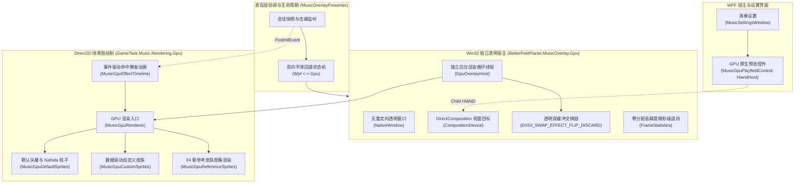

# DirectComposition 硬件加速悬浮谱面渲染引擎

BetterPetitPlanet 提供基于 DirectComposition、Direct2D 1.1 与 Direct3D 11 的硬件加速悬浮谱面渲染引擎（GPU Music Overlay）。该引擎与默认的 WPF 原生渲染管线（DrawingVisual）保持无缝互换，旨在以极低 CPU 负载和零拷贝透明交换链呈现高帧率、无撕裂的音游交互谱面。

---

## 1. 架构总览与硬件管线

系统采用分层解耦的硬件加速架构：



---

## 2. 核心技术实现特性

### 2.1 独立透明宿主与 DirectComposition 视口
- **无重定向表面（No Redirection Bitmap）**：Win32 窗口配置 `WS_EX_NOREDIRECTIONBITMAP` 与 `WS_EX_TRANSPARENT`，跳过传统 DWM 桌面合成的 GDI/WPF 脏矩形拷贝，将 D3D11 渲染结果直接交由硬件合成器。
- **透明交换链**：采用 `DXGI_FORMAT_B8G8R8A8_UNORM` 与 `DXGI_SWAP_EFFECT_FLIP_DISCARD`，启用 `DXGI_ALPHA_MODE_PREMULTIPLIED` 预乘透明度合成。
- **点击穿透与防抢焦点**：窗口创建带有 `WS_EX_TOOLWINDOW`，不在任务栏显示图标，不夺取游戏输入焦点，确保键盘按键精准到达前台游戏。

### 2.2 全量 24 款内置参考皮肤原生支持
- **全覆盖原生渲染**：涵盖 C1 批次（雷电将军、纳西妲等 13 款）与 C2 批次（芙宁娜等 11 款）。Direct2D 专用位图缓存池、帧动画图集索引及角色动态色彩由 GPU 管线接管，不再回退 WPF。
- **动态图集解码**：支持高分辨率图集按需裁剪与缓动动画，完全消除传统多图频繁切换引起的纹理换入换出开销。

### 2.3 默认与自定义皮肤支持
- **默认皮肤 (`default`)**：包含 7 轨道几何引导线、四叶草判定线、和弦同步连线、64 帧高分辨率 Nahida 命中图集以及 4 层程序化长按光环粒子系统（径向光晕、冲击环、中央符记与漂移粒子）。
- **自定义皮肤包 (`data/music-skins/<id>`)**：数据驱动配色、独立图片纹理绑定与 4 层动态扩散冲击环。

### 2.4 设置页硬件加速预览控件 (`MusicGpuPlayfieldControl`)
- 设置页中的谱面预览并非 WPF 模拟，而是通过 `HwndHost` 承载的独立 Win32 子窗口。
- 内部同样挂接 DirectComposition 交换链，在设置界面实现 100% 还原真实悬浮窗的硬件加速呈现。
- 鼠标滚轮和点击测试通过拦截 `WM_NCHITTEST` 并返回 `HTTRANSPARENT`，使 WPF 外层滚动条（`ScrollViewer`）能够顺畅穿透滑动，杜绝了传统 HwndHost 的空洞效应（Airspace Issue）。

### 2.5 事件驱动命中爆发架构 (`MusicGpuEffectTimeline`)
- 放弃传统基于 50ms 状态快照轮询的判定方式。
- 底层按键触发时，由 `IMusicOverlayGpuBackend.PostHitEvent` 将精确时间戳投递至 GPU 时间轴队列。
- 消除任何因 UI 调度器延迟造成的特效丢帧与时间走样。

### 2.6 零分配微秒级性能遥测 (`FrameStatistics`)
- 进程内采用高精度单调时钟（`Stopwatch.GetTimestamp()`）跟踪以下指标：
  - `RenderDurationUs`：Direct2D 渲染命令记录耗时；
  - `PresentWaitDurationUs`：等待垂直同步或呈现队列让出耗时；
  - `CadenceIntervalUs`：端到端真实呈现间隔，用于分析 60Hz/120Hz 下的微卡顿（Stutter）；
  - `DroppedFrames` 与 `DeviceLossCount`。
- 整个遥测链路采用结构体定长循环记录，内存零 GC 分配。

---

## 3. 双向容灾回退状态机

系统在 `MusicOverlayPresenter.Gpu.cs` 中维持严格的健壮性容灾策略：
1. **配置驱动**：`MusicOverlay.Backend` 为 `0` 时使用 WPF，为 `1` 时启用 GPU；
2. **初始化与设备丢失自动降级**：
   - 若系统不支持 DirectComposition、Direct3D 11 驱动异常或发生 `DXGI_ERROR_DEVICE_REMOVED`；
   - 系统自动捕获异常，销毁 GPU 宿主，在无卡顿前提下立即平滑回退至成熟的 WPF DrawingVisual 管线；
   - 界面状态栏上报结构化诊断信息（`OverlayBackendDiagnostic`），提示用户具体错误并允许重新应用。

---

## 4. 配置与启用说明

配置项位于 `config/config.json` 中的 `MusicOverlay.Backend` 字段：
- `0`：WPF 原生渲染器（默认基线，兼容性最广）；
- `1`：DirectComposition GPU 加速渲染器（实验性，极高帧率与极低 CPU 负载）。

在图形界面中，用户可通过“演奏设置” $\rightarrow$ “悬浮谱面设置”勾选“GPU 渲染（实验）”开关即可无缝切换，设置即时保存生效。

---

## 5. 打包与产物验证

使用 `Tools/PackageMusicGpuValidation.ps1` 脚本可打包独立的硬件加速验证产物：
```powershell
.\Tools\PackageMusicGpuValidation.ps1 -Destination <OutputDir> -OcrModelDirectory <ModelDir> -RecorderScorePath <ScorePath>
```
该脚本在打包时会自动校验关键二进制依赖（Vortice 跨平台 DirectX 图形库、NativeDefault 资源完整性及 SHA256 哈希），并将本文档作为 `README-GPU.md` 输出至发行目录。
