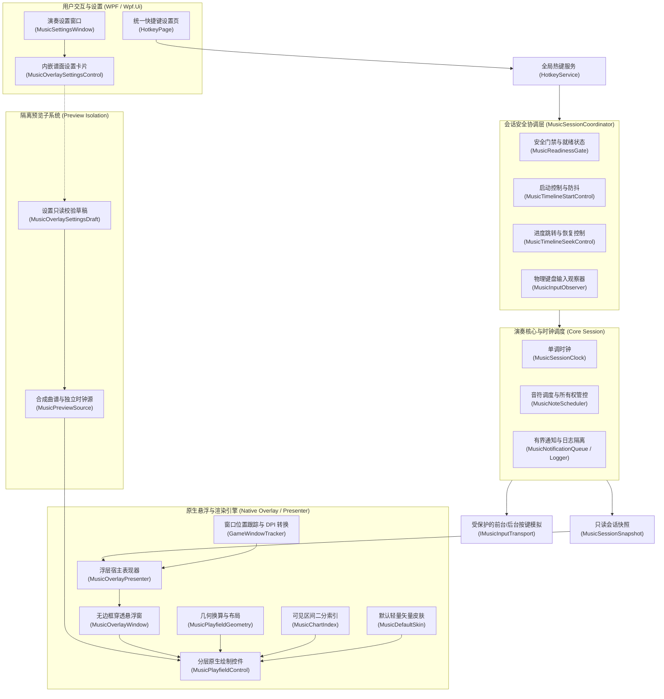

# 音乐会话调度与原生谱面渲染引擎

BetterPetitPlanet 提供乐谱解析（简谱与来源曲谱适配）、基于单调时钟的演奏调度，以及纯原生谱面悬浮渲染系统（Native Music Overlay）。系统基于 .NET 8 与 WPF 原生图形管线构建；项目文件和发布脚本不声明 Node.js/Bun 或 WebView2 构建依赖。

---

## 1. 总体系统架构

系统采用分层解耦与依赖倒置设计，将用户交互、会话安全协调、核心演奏时钟、原生图形渲染与隔离预览清晰划分为独立边界：



---

## 2. 曲谱语法树、归一化与来源适配

### 2.1 简谱语法支持 (`PetitScoreParser`)
解析器能够将通用文本简谱或 MIDI 简化结构转化为顺序播放队列：
- **基本唱名**：`1`、`2`、`3`、`4`、`5`、`6`、`7`，对应自然音阶中的 Do、Re、Mi、Fa、Sol、La、Ti。
- **音高八度修饰**：
  - 低音修饰：数字下方加点或字符前缀（如 `-1`、`-5`）。
  - 高音修饰：数字上方加点或字符前缀（如 `+1`、`+3`）。
- **休止符**：`0` 代表休止，持续一个基准时值。
- **时值修饰**：
  - 增时线（`-`）：音符后追加 `-` 延长一拍（如 `1 - - -` 表示四拍长音）。
  - 减时线（下划线或 `/`）：缩短时值至二分之一、四分之一。
- **多音和弦**：使用括号包裹同一瞬间触发的组合键（如 `(135)` 代表三和弦同时按下）。

### 2.2 曲谱归一化管线 (`ScoreNormalizer`)
`ScoreNormalizer` 对解析产物进行严谨验证与时间轴重整，生成只读排序的 `PerformanceEvent` 序列：
- 每个音符包含 `NoteId`、`Key`、`TimeMs`、`DurationMs`、`NoteType` 及可选的 `SyncGroupId`。
- **类型规范**：仅支持 `tap`（点按）与 `hold`（长按）。点按脉冲归一化为 20–500ms；显式长按必须具备大于零的持续时间。
- **重叠校验**：严格校验负时间、无效时长、同时间同轨道多音符冲突，以及涉及 hold 的同轨道区间交叉重叠。验证算法向前核查所有未闭合区间，避免短 tap 遮盖长 tap 导致的潜在区间冲突。
- **首音对齐与同步标识**：将谱面首个有效音符对齐至时间零点；同起点跨轨道的多音符自动分配确定的 `SyncGroupId`，便于渲染层绘制和弦同步连线。

### 2.3 来源曲谱适配器 (`SourceChartAdapter`)
`SourceChartAdapter.AdaptJson` 支持外部曲谱源的 `buttonSequence` 格式。调用者显式提供按钮到 `MusicLane`（A/S/D/F/J/K/L）的映射表。适配器对事件时间与持续时长进行整数校验与数据清洗，过滤无效旋律条目，保证输入到会话调度器的曲谱严格自洽。

---

## 3. 单调时钟与调度控制

### 3.1 混合自旋等待策略（Hybrid Spin-Wait）
`MusicSessionClock` 使用 `Stopwatch.GetTimestamp()` 提供的单调时间戳和两段式混合等待。操作系统调度和计时分辨率受机器及运行环境影响；本方案描述调度策略，不代表按键延迟或抖动的实测结果：

```csharp
long targetTicks = eventItem.TimestampTicks;
while (true)
{
    long remainingTicks = targetTicks - Stopwatch.GetTimestamp();
    if (remainingTicks <= 0) break;
    
    double remainingMs = (double)remainingTicks / Stopwatch.Frequency * 1000.0;
    
    // 剩余时间大于 2ms 时，让出操作系统时间片
    if (remainingMs > 2.0)
    {
        Thread.Sleep(1);
    }
    // 剩余时间进入最后 2ms 时，转入短时主动等待（SpinWait）
    else
    {
        Thread.SpinWait(10);
    }
```

系统利用混合自旋等待策略，在保障调度精度的同时有效避免了高频忙等待抢占 CPU 资源。

### 3.2 时钟状态与控制语义
- **播放 (`Play`)**：启动或恢复谱面。若存在准备时长（默认 3000ms），谱面时钟从负数（如 `-3000ms`）开始倒数，状态处于 `preparing`，音符下落动画平滑推进至零点开弹。
- **暂停 (`Pause`)**：冻结当前时钟位置，并立即释放所有由自动演奏持有的按键。
- **停止 (`Stop`)**：重置时钟位置为零，全面释放按键并开启一轮全新的按键释放恢复预算。
- **进度跳转 (`Seek`)**：立即释放当前按键，递增会话版本号（`Revision`），重新定位时钟并重排未来音符事件。Seek 到 hold 中途不会补发其历史 down 事件。
- **播放倍速 (`PlaybackSpeed`)**：支持 0.2x – 5.0x 动态倍速调节。调整速度时首先固定已演奏的绝对时间，仅缩放未来流逝的单调时钟，避免位置突跳。
- **跟弹模式 (`StartFollowAlong`)**：仅驱动时间轴与悬浮谱面推进，不注入任何自动物理按键，专供玩家看着谱面进行手动练习。

---

## 4. 输入所有权与异常恢复生命周期

### 4.1 严格所有权模型（Input Ownership）
`MusicNoteScheduler` 维持严密的按键所有权状态机：
- **仅对成功拥有的键负责**：只有底层 `IMusicInputTransport` 明确返回成功的 `KeyDown` 操作，调度器才会将该键登记为 `OwnedKey`。
- **硬件标记隔离**：键盘模拟注入时附带 `HardwareInputSimulator.MusicInputMarker`，使宿主输入监听系统能够精准区分“用户物理击键”与“自动化脚本击键”，杜绝自触发死循环。
- **原路由释放**：每个 `OwnedKey` 记录触发时的原始窗口句柄与输入模式（键盘/鼠标）。无论后续输入模式或焦点如何切换，`KeyUp` 均沿原路由精准投递释放。

### 4.2 释放预算与有限重试机制
为了防止因系统卡顿、窗口失焦或句柄失效导致游戏内按键“卡死长鸣”：
- 到期、暂停、停止、Seek、Readiness 失效、模式切换及应用退出统一受每键释放预算（`ReleaseRetryAttempts`，默认 3 次；`ReleaseRetryIntervalMs`，默认 10ms）管控。
- 重试间隔使用单调物理时间（Wall Time），不受倍速调节或暂停影响。
- 重试耗尽后记录结构化错误日志，保留未释放键诊断信息，不在高频调度循环中无限抛发无效按键。只有用户显式调用 `Stop` 才能重置并开启新一轮恢复预算。

### 4.3 有界通知队列与日志解耦
- `MusicNotificationQueue`：以无锁有界循环队列隔离调度核心与外部观察者。高频位置快照自动合流为最新值；当队列超限时丢弃旧特效帧、增加 revision 并发布当前 owned-key 关键快照，绝不阻塞时间调度线程。
- `MusicSessionLogger`：独立单消费者异步写出日志，日志格式化和写入不在调度调用栈中同步执行；其对系统资源的实际影响尚未测量。

---

## 5. 会话安全协调器 (`MusicSessionCoordinator`)

`MusicSessionCoordinator` 作为高层业务与核心会话之间的安全守门人，彻底解耦了演奏生命周期与视图/输入宿主：

1. **环境感知与就绪门禁 (`MusicReadinessGate`)**：
   - 持续汇聚游戏前台状态（`GameProcessDetector`）、乐器界面 ROI 特征匹配（`InstrumentDetector`）、图像捕获流健康度（`GameTaskManager`）与自动拾取状态（`AutoPickTrigger`）。
   - **防抖与滞回决策**：配置 `ReadySuccessCount`（默认 2）与 `ReadyFailureCount`（默认 3），并执行特征新鲜度过期校验（`DetectionFreshnessMs`、`CaptureFreshnessMs`）。
   - 任一前置条件失效时，协调器触发暂停并释放按键；当条件重新满足时，保持暂停就绪状态，**绝不擅自自动续播**，必须等待用户显式确认。
2. **过时请求取消与防抖控制 (`MusicTimelineStartControl`)**：
   - 玩家快速连续点击播放/暂停、连续切换歌曲或调整进度时，内部通过原子 Token 立即取消尚未唤醒的历史延时任务，防止旧曲目在数秒后意外唤醒发声。
3. **安全与显示完全正交**：
   - 无论原生悬浮窗是否启用（`MusicOverlayConfig.Enabled` 为 false 时）、窗口是否隐藏或渲染是否异常，**后台前台守护与安全释放逻辑始终全权生效**。

---

## 6. 原生谱面渲染引擎（Native Music Overlay）

BetterPetitPlanet 的音乐谱面浮层由 WPF 原生绘制管线承载，不再使用 WebView2 / PixiJS 网页浮层。

### 6.1 分层原生绘制 (`MusicPlayfieldControl` & `MusicPlayfieldDrawing`)
`MusicPlayfieldControl` 继承自 WPF `FrameworkElement`，内部管理 `VisualCollection`，绘制时使用 `DrawingVisual` 与 `DrawingContext`。实现不会为每个音符创建独立的 `FrameworkElement`、WPF 控件或依赖属性绑定；具体绘制开销尚未测量：

绘制层级自底向上严格分层：
1. **轨道背景与引导线**：绘制 7 条竖向轨道几何区域、半透明背景板与列分割线。
2. **判定线与键位标签**：在下落底部绘制高亮判定线，并标注 A/S/D/F/J/K/L 琴键字符。
3. **和弦同步连线**：基于同一 `SyncGroupId` 的跨轨多音符，实时绘制水平连接桥与关联标记。
4. **长按条（Holds）**：区分长按身体段落、头部与尾部；处于被按住状态的长按音符呈现动态光晕流动。
5. **单点音符（Taps）**：绘制圆角音符块与边框高亮。
6. **打击反馈与按键高亮**：根据 `OwnedKey` 状态与物理键盘观察状态，区分自动输入与手动输入所有权，高亮当前键位并绘制扩散粒子特效。

```csharp
// 典型分层绘制管线示例
protected override void OnRender(DrawingContext dc)
{
    // 1. 轨道与基准引导
    MusicPlayfieldDrawing.DrawLanes(dc, geometry, skin, options);
    // 2. 判定线与按键提示
    MusicPlayfieldDrawing.DrawJudgementLine(dc, geometry, skin);
    MusicPlayfieldDrawing.DrawKeyLabels(dc, geometry, skin);
    // 3. 和弦连接
    MusicPlayfieldDrawing.DrawSyncLines(dc, geometry, skin, activeNotes);
    // 4. 音符实体 (Holds & Taps)
    MusicPlayfieldDrawing.DrawNotes(dc, geometry, skin, activeNotes, currentDisplayMs);
    // 5. 命中特效与键位高亮反馈
    MusicPlayfieldDrawing.DrawHitEffects(dc, geometry, skin, activeKeys);
}
```

### 6.2 默认矢量皮肤 (`MusicDefaultSkin`)
- 系统内置一套完全由 C# 代码与矢量几何生成的默认原生皮肤，包含音符颜色、轨道明暗、判定线样式与光效参数。
- 随主程序二进制编译发布，体积占用不足 100 KB，**无需随包携带数百张散装 PNG 图片**，启动即可瞬时完成初始化。
- 所有 `Brush` 与 `Pen` 均在加载时调用 `.Freeze()`，杜绝跨线程复制与渲染管线不必要的重绘开销。

### 6.3 单调时钟推算与可见区间索引
- **单调渲染推算**：渲染引擎每帧根据当前单调时钟独立推算谱面显示位置：
  $$\text{DisplayTimeMs} = \text{PositionMs} + (\text{CurrentMonotonicMs} - \text{HostMonotonicMs}) \times \text{PlaybackSpeed} + \text{VisualOffsetMs}$$
  - 仅在 `Playing` 或 `Preparing` 状态下外推时钟；在暂停、停止或等待状态下保持静止。
  - 视觉偏移量（`VisualOffsetMs`，范围 -2000ms ~ +2000ms）仅作用于坐标计算，绝不影响底层发键物理时钟。
- **可见区间二分索引 (`MusicChartIndex`)**：
  - 谱面加载时一次性构建按时间排序的只读索引。
  - 渲染帧根据下落时长（`FallDurationMs`）算出可视时间窗口 $[t_{\text{start}}, t_{\text{end}}]$。
  - 采用二分查找 `GetActiveNotes(visibleStartMs, visibleEndMs)`，复杂度降为 $O(\log N + M)$（$M$ 为当前屏幕可视音符数，通常仅几十个）。
  - **长按跨区间保护**：查询条件严格覆盖 `Note.EndTimeMs >= visibleStartMs && Note.TimeMs <= visibleEndMs`，确保头部已过去但尾部仍在屏幕上的持续长按绝不遗漏。

---

## 7. 浮层生命周期与宿主跟随

### 7.1 表现层协调器 (`MusicOverlayPresenter`)
`MusicOverlayPresenter` 负责驱动原生悬浮窗口（`MusicOverlayWindow`）的全部生命周期：
- **按需创建与惰性初始化**：仅在谱面启用（`Enabled`）且有演奏/跟弹需求时创建悬浮窗；关闭时自动销毁。
- **宿主窗口跟随与 DPI 自适应 (`GameWindowTracker`)**：
  - 通过 Win32 API 轮询监测《星布谷地》客户区屏幕物理矩形。
  - 将物理像素（Physical Pixels）换算为 WPF 设备无关像素（DIP），实现中包含 Per-Monitor V2 DPI 处理；真实游戏中的多 DPI、全屏和窗口移动行为仍待桌面验收。
  - 游戏最小化、全屏切换或移动窗口时，跟随逻辑会更新坐标并裁剪区域；实际表现仍待桌面验收。
- **点击穿透与录屏兼容**：
  - 悬浮窗配置 `WS_EX_TRANSPARENT` 与 `WS_EX_TOOLWINDOW` 扩展样式，意图提供鼠标点击穿透并避免显示任务栏图标；真实游戏中的焦点和点击行为仍待验收。
  - 实现没有设置 `WDA_EXCLUDEFROMCAPTURE` 标志；OBS、截图工具和推流软件的实际捕获效果尚未验证。
- **渲染帧回调有界调度**：
  - 仅在悬浮窗可见且处于播放态时才向 `CompositionTarget.Rendering` 注册帧渲染回调。
  - 游戏失焦、最小化、谱面隐藏或暂停且无残留粒子时，代码会解绑回调；待机 CPU/GPU 占用尚未测量。

### 7.2 交互式位置调整模式
当用户在设置中点击“调整位置”时：
1. 协调器暂停并释放当前自动输入，解除 `WS_EX_TRANSPARENT` 穿透样式。
2. 悬浮窗显示调整边框与拖动十字手柄，支持鼠标直接拖拽移动与拉伸大小。
3. 用户完成调整、取消调整、或窗口意外关闭时，自动保存最新坐标（归一化为相对客户区比率 `0.0~1.0`），并原子恢复点击穿透保护。

---

## 8. 只读草稿与合成隔离预览

为了让玩家在调整下落速度、视觉偏移与显示特效时能够即时看到视觉反馈，同时杜绝配置未保存即污染主配置或引发误触：

### 8.1 设置只读草稿 (`MusicOverlaySettingsDraft`)
- 演奏设置页面（`MusicOverlaySettingsControl`）内部持有独立的草稿对象。
- 玩家调整滑条、开关特效时，草稿仅在内存中即时校验数值范围。
- 只有用户显式点击“应用谱面设置”时，草稿才经过二次强校验并持久化写入 `IConfigService`。
- 直接关闭窗口或切换页面将自动丢弃未保存的草稿，恢复上一版持久化配置。

### 8.2 合成隔离预览源 (`MusicPreviewSource`)
设置窗口内嵌的动态小预览控件完全与真实演奏环境隔离：
- **零真实按键依赖**：预览源不持有任何 `IMusicInputTransport`，绝不注入系统按键。
- **零游戏窗口关联**：不调用 `GameProcessDetector`，不激活游戏窗口，不依赖乐器前台状态。
- **合成测试数据**：内置一组兼具 7 轨道、单点跳音、长按拖尾与三和弦同步音的循环合成曲谱，由独立的内部单调时钟驱动。
- **生命周期即时销毁**：预览默认处于静态展示态，用户点击“试听/播放预览”后方启动动画；关闭设置窗口时立即退订渲染事件并释放资源，绝无后台常驻残留。

---

## 9. 统一快捷键管理与原子回滚

### 9.1 六大核心热键规范
在全局“快捷键”设置页（`HotkeyPage`）与统一控件（`HotkeySettingRow`）中统一部署管理：

| 快捷键功能 | 默认绑定 | 语义说明 | 生效范围 |
| :--- | :---: | :--- | :--- |
| **自动演奏** | `F9` | 启动或暂停物理自动按键模拟与时间轴 | 演奏前台 |
| **跟弹时间轴** | `Ctrl+F9` | 仅启动/暂停谱面下落与时间轴，不模拟按键 | 手动跟弹 |
| **谱面显隐** | `Ctrl+F12` | 切换原生悬浮窗显示/隐藏（不改变演奏状态） | 全局浮层 |
| **上一首** | `F10` | 切换到曲库中的上一首曲目 | 演奏会话 |
| **下一首** | `F11` | 切换到曲库中的下一首曲目 | 演奏会话 |
| **自动拾取** | `F8` | 开启或关闭 OCR 自动拾取辅助循环 | 游戏全局 |

### 9.2 冲突检测与原子注册回滚 (`HotkeyService`)
系统级全局热键（`RegisterHotKey`）不具备跨进程事务机制。为此 `HotkeyService` 实现了严密的检验与回滚控制：
1. **严格静态校验**：检测按键是否重复绑定；检测按键是否与《星布谷地》核心演奏琴键（`A`、`S`、`D`、`F`、`J`、`K`、`L`）冲突；拦截非法无效按键。
2. **原子性探测与注册**：在持久化保存配置之前，先在系统层尝试注册全量新热键。
3. **失败原子回滚与状态可见**：
   - 若某快捷键已被其他第三方软件（如截图软件、输入法）独占导致注册失败，服务立即注销已注册的新键，并**原子回滚恢复上一组全部有效热键绑定**。
   - 界面清晰呈现具体是哪一个热键在系统层注册失败，杜绝“注册失败却假装显示已应用”的状态不一致隐患。

---

## 10. 验证与测试规范

系统包含覆盖主要音乐功能的单元测试与集成测试。

### 10.1 关键测试套件分布
- **曲谱与时钟测试**：`PetitScoreParserTest.cs`、`ScoreNormalizerTest.cs`、`SourceChartAdapterTest.cs`、`MusicRenderClockTest.cs`。
- **输入所有权与释放预算**：`MusicNoteSchedulerTest.cs`、`MusicInputOwnershipTest.cs`、`MusicReleaseBudgetTest.cs`。
- **安全门禁与就绪状态**：`MusicReadinessGateTest.cs`、`MusicPlaybackSafetyTest.cs`、`MusicTimelineStartControlTest.cs`、`MusicTimelineSeekControlTest.cs`。
- **原生几何与区间查找**：`MusicChartIndexTest.cs`、`MusicPlayfieldGeometryTest.cs`。
- **草稿校验与合成隔离**：`MusicOverlaySettingsTest.cs`、`MusicPreviewIsolationTest.cs`。
- **浮层表现与热键回滚**：`MusicLayoutAdjustmentTest.cs`、`MusicHotkeyApplyTest.cs`。

### 10.2 自动化测试运行指令
通过隔离虚拟输入桩（Fake Transport）执行全量回归测试：

```powershell
dotnet test Test/BetterPetitPlanet.Test/BetterPetitPlanet.Test.csproj -c Release -p:Platform=x64 --filter "FullyQualifiedName~Music|FullyQualifiedName~PetitScoreParser" --logger "console;verbosity=minimal"
```

> [!NOTE]
> 包含真实前台激活与系统物理按键发送的用例使用 `[MusicDesktopInputFact]` 进行了显式隔离，默认自动跳过。仅在具备真实 Windows 交互桌面的专用测试环境下设置环境变量 `PETIT_MUSIC_DESKTOP_TESTS=1` 时才会触发实机物理按键。

---

## 11. 延伸参考
- [DirectComposition 硬件加速悬浮谱面渲染引擎](gpu-music-overlay.md)
- [原生谱面皮肤 Schema 与资源限额规范](music-skin-schema.md)
- [原生悬浮窗与快捷键配置样例](music-overlay-config.example.json)
