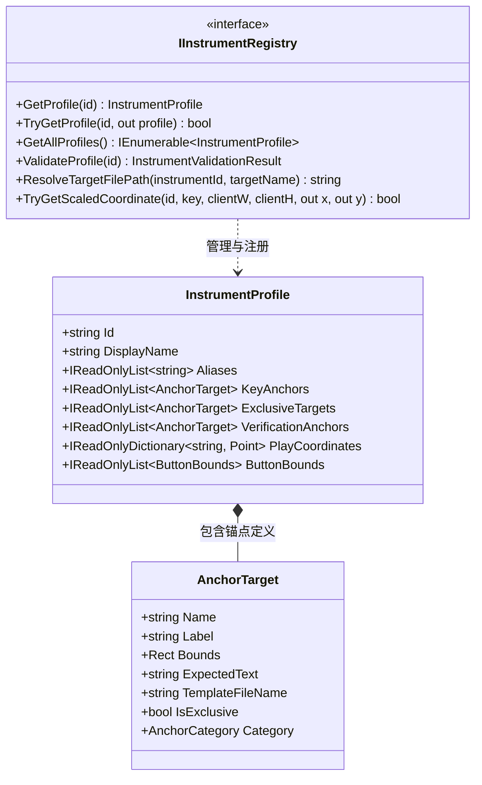
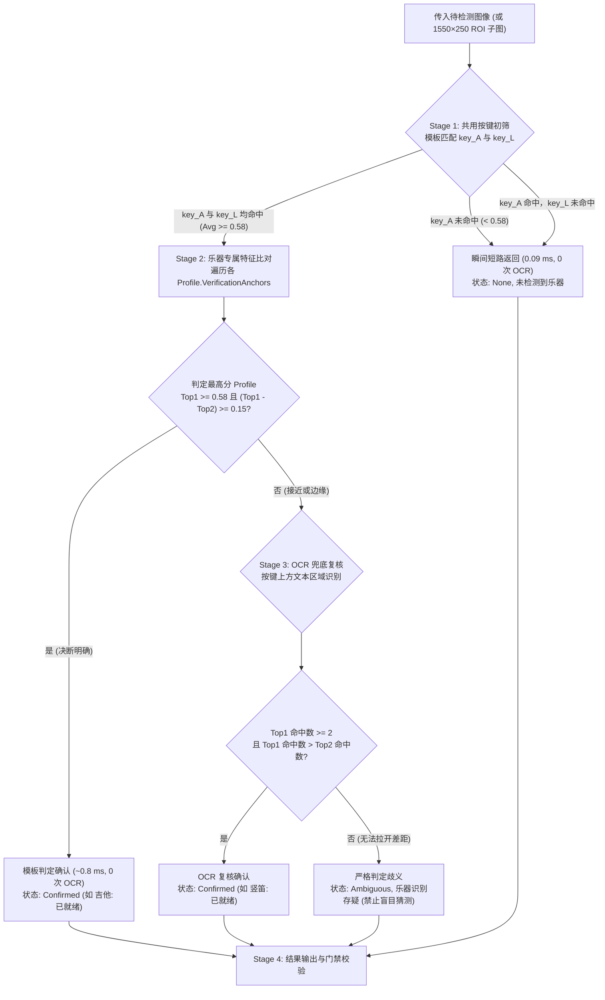

# 多乐器识别系统与演奏架构技术文档

在《星布谷地》的乐器自动演奏模块中，系统支持多种演奏界面的实时识别与演奏门控控制。目前已完整支持**竖笛（Recorder）**与**吉他（Guitar）**，并通过配置驱动体系为未来乐器接入预留了标准接入点。

---

## 1. 乐器资产目录与物理隔离规范

为了避免不同乐器及其模板文件散乱杂糅，资产统一组织在 `BetterPetitPlanet/Assets/Instruments/` 下，遵循**通用按键收归、专属特征独立**的规范：

```text
Assets/Instruments/
├── common/                               # 跨乐器公共按键资源（7 键快捷键图标）
│   ├── key_A.png
│   ├── key_S.png
│   ├── key_D.png
│   ├── key_F.png
│   ├── key_J.png
│   ├── key_K.png
│   └── key_L.png
│
├── Recorder/                             # 竖笛专属资源
│   ├── template.png                      # 竖笛整块底模（兼容兜底）
│   └── targets/                          # 竖笛专属小图（数字 1~7、唱名 do~ti）
│       ├── 1.png ~ 7.png
│       └── do.png ~ ti.png
│
└── Guitar/                               # 吉他专属资源
    ├── template.png                      # 吉他整块底模（兼容兜底）
    └── targets/                          # 吉他专属和弦小图（Pascal VOC 原生裁剪）
        ├── C.png, Dm.png, Em.png, F.png, G.png, Am.png, G7.png
```

### 规范约束
- **公共按键只存一份**：吉他与竖笛的底部 7 个物理快捷键（`key_A` 到 `key_L`）像素完全一致（2560×1440 原生坐标 `y: 1272~1310`，尺寸 `48×38`，中心字形零像素差异），全部收归 `common/` 目录，杜绝无意义冗余。
- **专属特征物理隔离**：吉他独有的 7 个和弦小图置于 `Guitar/targets/`，竖笛独有的数字与唱名小图置于 `Recorder/targets/`。
- **自动构建分发**：工程文件配置 `<None Update="Assets\**">` 保证所有目录与小图在 Debug/Release 构建及发布时全量自动同步。

---

## 2. 配置驱动多乐器架构设计

系统采用**配置驱动（Profile-Driven）**架构，通用检测算法在主干执行，乐器特征、坐标与判定规则由乐器配置档案定义。



### 核心特性
1. **多重别名与自适应寻址**：支持通过 `Recorder/竖笛/flute`、`Guitar/吉他` 等大小写不敏感别名快速检索档案。
2. **多级模板解析与容错回退**：`ResolveTargetFilePath` 按照 `乐器专属 targets/` → `common/` → `Recorder targets/ (历史回退)` 智能查找资源。
3. **坐标自适应换算**：统一以基准 2560×1440 维护点击中心点（纵向中心均为 `Y=1230.0`），运行时根据客户端窗口尺寸自动线性缩放。

---

## 3. 分阶段低开销短路识别算法 (Four-Stage Pipeline)

为了消除旧系统每秒全量 OCR 的高昂开销，新算法设计为**由外至内、逐级确认、极速短路**的四阶段识别流程：



### 阶段详解
1. **Stage 1 (共用键初筛短路)**：
   - 使用 `common/key_A.png` 与 `common/key_L.png`。在普通游戏、主界面或背包状态下，`key_A` 匹配直接失配退出，耗时 **0.09 ms**，完全不调用 OCR。
2. **Stage 2 (专属特征纯模板判定)**：
   - 提取吉他外缘特征（`C` 与 `G7`）与竖笛外缘特征（`1` 与 `7`）。
   - 必须同时满足 **分值达标 ($\ge 0.58$)** 与 **领先安全裕度 ($\Delta \ge 0.15$)**。正常持握状态下得分通常达 $0.85 \sim 0.95$，单次比对耗时 **$< 0.9\text{ ms}$**，直接确认为对应乐器，**完全无需 OCR**。
3. **Stage 3 (OCR 兜底复核与存疑保护)**：
   - 仅当模板被部分遮挡、光线异常导致置信度存疑且打平时介入。
   - 识别 7 个键位上方区域文本。若一方字符命中数 $\ge 2$ 且领先另一方，完成复核；若仍无法明确区分，**严格返回 Ambiguous（乐器识别存疑），绝不凭前后顺序盲目猜测**。
4. **Stage 4 (动态状态呈现与指标规范)**：
   - 真实输出所处阶段与实际指标（如 `吉他: 已就绪 (模板: 96%)`、`竖笛: 已就绪 (OCR: 86%)`、`未检测到乐器`、`乐器识别存疑`）。
   - **未执行 OCR 时严禁虚构或输出虚假 OCR 百分比**。

---

## 4. 性能优化与并发安全

### 4.1 截图克隆内存吞吐优化 (降低 89.5%)
- **原问题**：捕获循环与检测触发器频繁全帧深拷贝 2560×1440 画面（单帧 14.75 MB），造成超 700 MB/s 的内存带宽压力。
- **优化方案**：`InstrumentDetectorTrigger` 在投递后台 Task 时，基于目标窗口分辨率计算乐器底部区域外接矩形（2560×1440 原生下为 `X: 500, Y: 1100, W: 1550, H: 250`），仅截取该子区域克隆（约 1.55 MB），**单次检测克隆体积骤降 89.5%**。

### 4.2 锁外通知与死锁根除
- **原问题**：`InstrumentDetector.DetectFull` 在持有 `_syncLock` 私有互斥锁内部触发 `DetectionUpdated` 事件，而 UI 订阅者使用同步 `Dispatcher.Invoke`，产生跨线程双向死锁风险。
- **优化方案**：
  1. 核心计算与 `LatestResult` 更新仍在 `lock (_syncLock)` 保护下执行；
  2. `DetectionUpdated?.Invoke(result)` 严格移至**互斥锁外部**安全触发；
  3. `MusicPageViewModel` 中的订阅回调全部升级为异步 `Dispatcher.InvokeAsync`，彻底断开锁与 UI 消息泵的死锁闭环。

### 4.3 乱序丢弃与时序保护
- `InstrumentDetectorTrigger` 维护递增的单调序列号 `_sequenceCounter` 与 `_lastCompletedSequence`。后台 Task 若乱序晚于新帧返回，旧帧结果被自动丢弃，杜绝状态回退与高频闪烁。

---

## 5. 播放就绪安全门禁 (Readiness Gate)

### 5.1 曲谱意愿与画面现实的双向一致性比对
```text
┌───────────────────────────────────────────────┐
│ 曲谱目标乐器 (Timeline.Metadata.Instrument)     │
│ - 用户意愿，来自曲谱文件元数据或曲库筛选         │
└──────────────────────┬────────────────────────┘
                       │ 严格比对 (MatchesInstrument)
                       ▼
┌───────────────────────────────────────────────┐
│ 画面实际检出乐器 (InstrumentDetectionResult)   │
│ - 物理事实，来自实时视觉检测器                  │
└───────────────────────────────────────────────┘
```
1. **一致放行**：当画面检测出的乐器与当前装载的曲谱乐器一致时，门禁判定为 `Ready = true`，文案格式化为 `"{DisplayName}已就绪"`。
2. **错位熔断**：若曲谱为吉他，画面却拿出了竖笛（或反之），门禁立即否决并返回 `Deny("乐器不匹配：当前曲谱为吉他，画面检测为竖笛")`。
3. **输入保护**：乐器未拿出、乐器消失或乐器不匹配时，`MusicSessionCoordinator` 立即挂起播放并命令 `MusicNoteScheduler.ReleaseAll()` 释放所有键盘按键，杜绝卡键与错音盲弹。
